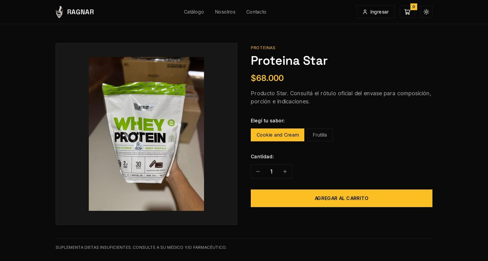

# Ragnar Suplementos

Tienda online para Ragnar, un comercio de suplementos deportivos de Formosa. Los clientes compran productos y combos con retiro en el local o envío en la ciudad, y el local administra el catálogo, los precios, el stock y las fotos desde la misma web.

Demo en preparación · [Caso de estudio](https://nelsonvis-portfolio.vercel.app/proyectos/ragnar-suplementos/)



> **English summary:** Online store for a sports supplement shop in Formosa, Argentina, built with Next.js and a Django REST API. Combos share stock with the single products, the server recalculates every total, each order reserves stock for 24 hours, and payments go through Mercado Pago, bank transfer or cash. The shop manages its catalog from a web panel.

## Qué hace

- Catálogo por categoría con sabores (cada sabor puede tener su foto) y combos con precio propio.
- Carrito guardado en el navegador. Se puede comprar como invitado o con una cuenta; las cuentas confirman el email y pueden recuperar la contraseña.
- Retiro en el local o envío dentro de Formosa. El servidor ubica la dirección, calcula la ruta y cobra por distancia: gratis hasta 1 km, ARS 1.000 hasta 3 km y así hasta 12 km.
- Pago con Mercado Pago, transferencia o en el local. Los pagos manuales quedan pendientes hasta que el local los aprueba en Django Admin.
- Cada pedido reserva el stock durante 24 horas. Si vence o se cancela, las unidades vuelven al inventario.
- Panel en `/administracion` para cargar productos, combos, precios, stock, publicación y fotos por sabor.
- Formularios de arrepentimiento, reclamo y consulta.

Un ejemplo: si un combo trae una proteína y una creatina, el combo muestra como stock el menor de los dos, y comprar 2 combos reserva 2 unidades de cada producto.

<p>
  
  
</p>

## Stack

| Parte | Tecnologías |
| --- | --- |
| Frontend | Next.js 16, React 19, TypeScript, Tailwind CSS 4, Zustand |
| Backend | Django 6.0, Django REST Framework, Simple JWT |
| Base de datos | PostgreSQL en producción, SQLite en desarrollo |
| Servicios | Mercado Pago, Cloudinary, SMTP, Nominatim y OSRM de OpenStreetMap |

## Decisiones técnicas

### El navegador no manda precios

El carrito vive en el navegador, así que cualquiera puede editarlo. Por eso guarda solo el artículo, el sabor y la cantidad. Al confirmar, `crear_preferencia` en [`backend/store/views.py`](backend/store/views.py) vuelve a leer productos y combos, recalcula el total y bloquea las filas de stock con `select_for_update()` dentro de la misma transacción.

### Combos sin stock propio

Un combo usa los mismos productos que se venden sueltos. Si tuviera stock propio, la misma unidad se podría vender dos veces. En [`models.py`](backend/store/models.py) el stock del combo es el menor de sus productos (cero si alguno está despublicado), y [`orders.py`](backend/store/orders.py) reserva una unidad de cada componente. Cada línea del pedido guarda la lista de componentes, así el stock se libera bien aunque el combo cambie después.

### Un pedido por intento de compra

Un doble clic o una conexión lenta pueden mandar el mismo pedido dos veces. El carrito genera una `checkout_key` por intento y el servidor la guarda como única en el pedido, junto con un hash del carrito. Si llega repetida con los mismos datos, devuelve el pedido que ya existe; si llega con otro carrito, responde 409.

### Pagos que llegan tarde o con otro importe

Mercado Pago avisa por webhook, puede repetir el aviso o llegar cuando la reserva ya venció. El webhook comprueba la firma, consulta el pago en Mercado Pago y compara moneda e importe con el pedido. Si algo no coincide o ya no hay stock, el pedido pasa a revisión (`revision_pago` o `revisar_stock`) para que lo resuelva una persona.

## Cómo correrlo

Necesitás Python 3.12 o más nuevo y Node.js 20.9 o más nuevo. Sin `DATABASE_URL`, Django usa SQLite.

Backend, desde la raíz:

```bash
cp .env.example .env
python -m venv backend/.venv
source backend/.venv/bin/activate
pip install -r requirements.txt
python backend/manage.py migrate
python backend/manage.py ensure_catalogo
python backend/manage.py createsuperuser
python backend/manage.py runserver
```

Frontend, en otra terminal:

```bash
npm ci
cp .env.local.example .env.local
npm run dev
```

Abrir http://localhost:3000. `ensure_catalogo` carga 14 productos y 5 combos con stock en cero; el stock se carga entrando con el superusuario a `/administracion`. En desarrollo los mails, incluido el link para confirmar una cuenta nueva, salen en la terminal de Django.

Las variables y el despliegue están en [docs/DESPLIEGUE.md](docs/DESPLIEGUE.md) y la API en [docs/API.md](docs/API.md).

## Tests

Desde `backend/`, con el entorno activado:

```bash
python manage.py test
```

Son 54 tests: permisos del panel, alta y edición de productos y combos, subida de imágenes, combos con productos despublicados, reserva de stock en el checkout, el total calculado con los precios del catálogo, la liberación de reservas vencidas, confirmación de email y recuperación de contraseña. Cloudinary y el correo están simulados. El frontend se revisa con `npm run lint` y `npx tsc --noEmit`.

## Estado

Funciona en local con SQLite o PostgreSQL. No hay demo pública todavía: [`render.yaml`](render.yaml) está preparado para el plan gratuito de Render, pero no hay un despliegue activo.

El flujo de Mercado Pago no tiene tests automáticos y necesita credenciales reales para probarse. El stock es uno por producto, compartido entre sus sabores. No hay historial de pedidos para el cliente, seguimiento de envíos ni cupones, y el repositorio no tiene CI.

## Qué aprendí

Aprendí que el checkout no termina cuando el cliente se va a pagar: hay reintentos, pagos que llegan tarde y reservas que vencen. Los combos me obligaron a pensar el stock como algo compartido entre productos y no como un número por artículo.

## Licencia

Todavía no tiene licencia.
