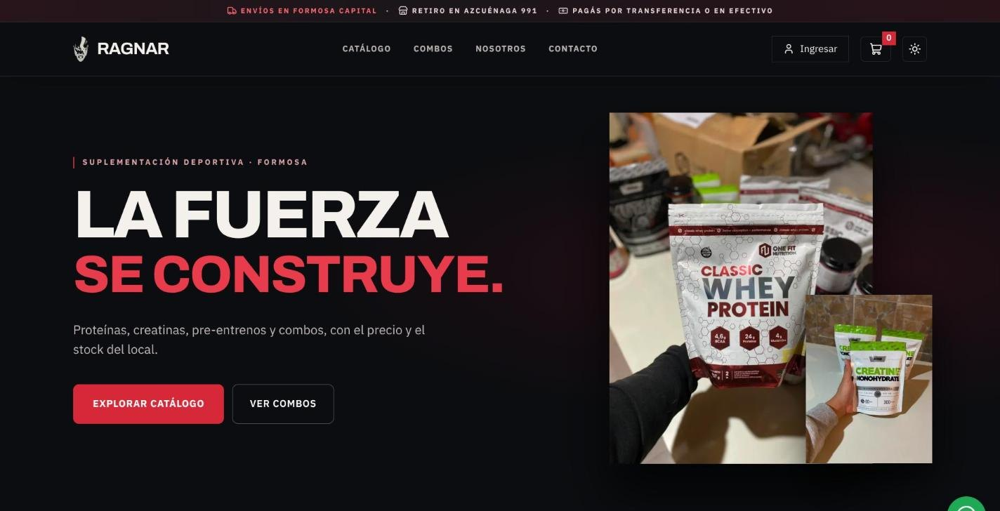
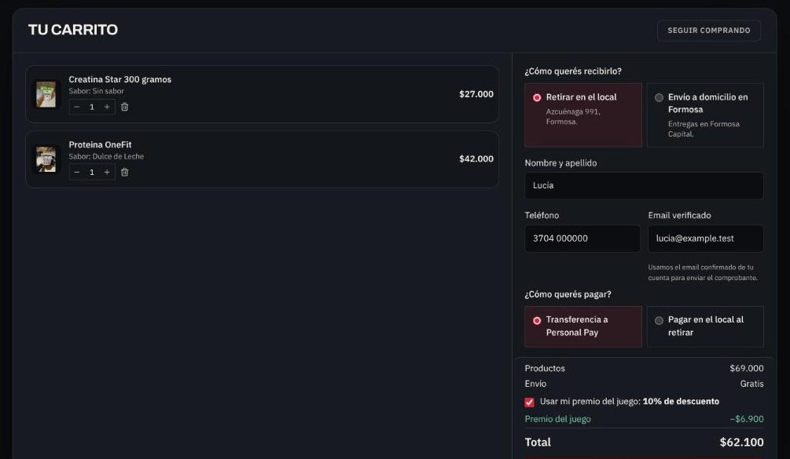
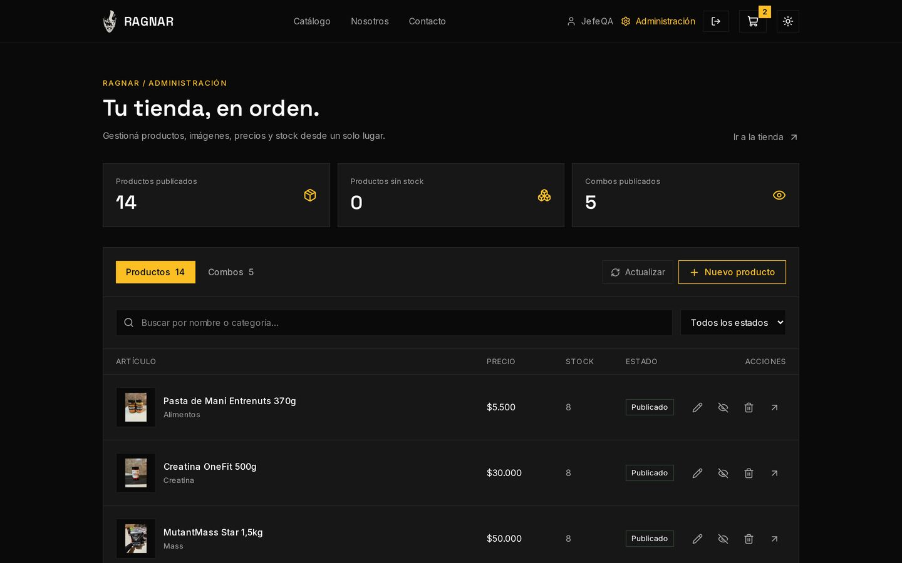

# Ragnar Suplementos

**A full-stack e-commerce application built for a sports nutrition business in Formosa, Argentina.**

Ragnar Suplementos connects a responsive storefront to an administrative system for products, bundles, stock, orders, and customer accounts. The central challenge was giving the business owner control over the catalog while keeping prices and inventory consistent throughout checkout.

**[Portfolio case study](https://nelsonsivisstum.vercel.app/en/projects/ragnar-suplementos/)** · **[API reference](docs/API.md)**

**Status:** tested in a local environment, not yet published.

## Screenshots

| Storefront | Cart with a game reward | Owner dashboard |
| --- | --- | --- |
|  |  |  |

*Screenshots use test data, not the store's real sales.*

## What problem does it solve?

The business needed to update its own inventory, prices, photos, and bundles without asking a developer for every change. A conventional storefront was not enough: the same product could also appear inside a bundle, so independently tracked quantities could lead to overselling. Ragnar keeps those rules on the Django backend instead of trusting values from the browser.

## Features

**Customers**
- Browse products by category, search and filter the catalog, and choose flavor variants.
- View bundles composed of products sharing the same inventory.
- Use a persistent shopping cart and a dedicated checkout page.
- Register, confirm an email address, sign in, and recover a password.
- Request local delivery quotes or choose store pickup.
- Pay by bank transfer, in cash on delivery, or at the store; Mercado Pago is an optional integration.
- Send a customer-service request or request product advice.
- Registered customers flip cards to win a 5 %, 10 % or free-shipping reward (one play on sign-up and another per approved purchase of five or more items); the discount is calculated on the server at checkout.

**Store owner**
- Manage categories, products, variants, bundles, images, pricing, and stock through `/administracion`.
- Search and filter orders, inspect their recorded items, and perform permitted order-state transitions.
- Review manually confirmed payments and cancel eligible orders with inventory restoration.
- Follow sales, visitors (counted without cookies or IP addresses), conversion, best sellers and low stock on a dashboard.
- Record in-store counter sales that deduct stock with the same locking as online checkout, and void them if entered by mistake.
- See registered customers with their approved purchases, answer customer-service requests, and tune the card game's odds.
- Edit transfer details, distance-based shipping rates and order-email messages without touching server configuration.
- Access Django Admin for the underlying records and customer-service requests.

## Technology

| Layer | Technologies |
| --- | --- |
| Frontend | Next.js 16, React 19, TypeScript, Tailwind CSS 4 |
| Client state | Zustand (persistent cart) |
| Backend | Python, Django 6, Django REST Framework, Simple JWT |
| Database | PostgreSQL; SQLite for local development |
| Infrastructure | Docker Compose, Nginx, Gunicorn, Redis |
| Integrations | Mercado Pago (optional), Cloudinary, email via SMTP or Resend, OpenStreetMap routing/geocoding |

## Engineering decisions

**The server owns prices and stock.** Django recalculates order totals from database records, validates availability, and rejects inconsistent checkout requests. The frontend cannot dictate final amounts.

**Products and bundles share inventory.** A bundle consumes stock from its constituent products. Locks and an ordered locking strategy help prevent concurrent purchases from reserving the same last unit.

**Checkout is designed for retries.** A checkout key detects duplicate attempts, while the order preserves purchased item names, prices, and quantities even if the catalog changes later.

**Administrative actions follow the order lifecycle.** Order-management requests validate permissions, state transitions, and record versions; sensitive operations are written transactionally.

See [the API reference](docs/API.md) for routes, authentication, errors, and administrative actions.

## Run locally

**Requirements:** Node.js 20.9+ and Python 3.12+. No production payment or email credentials are needed to inspect the application locally.

Clone the repository and create the backend configuration:

```bash
git clone https://github.com/nelsonvis3/ragnarsuplementosfsa.git
cd ragnarsuplementosfsa
cp .env.example .env
python -m venv backend/.venv
```

Activate the virtual environment with `source backend/.venv/bin/activate` (Bash/Zsh) or `source backend/.venv/bin/activate.fish` (Fish). Start Django from the repository root:

```bash
python -m pip install -r requirements.txt
python backend/manage.py migrate
python backend/manage.py ensure_catalogo
python backend/manage.py createsuperuser
python backend/manage.py runserver
```

In another terminal, still in the repository root, start Next.js:

```bash
npm ci
cp .env.local.example .env.local
npm run dev
```

Open **http://localhost:3000**; the default API runs at **http://127.0.0.1:8000**. Without `DATABASE_URL`, Django uses local SQLite. The initial catalog may contain items with **zero stock**; use the administrative interface to enter real quantities before trying checkout.

> In local development, emails normally appear in the backend terminal. External payments, image uploads, and delivery quotes require their respective services and configuration. Never commit real `.env` files or provider credentials.

## Tests and validation

```bash
npm run lint
npx tsc --noEmit
npm run build
python backend/manage.py test
```

The backend suite has 106 tests; on SQLite, 2 are skipped because they need PostgreSQL row locking.

## About this project / Sobre el proyecto

This is a real client-oriented project and a portfolio case study by **Nelson Sivisstum**. Business names, logos, and product imagery belong to their respective owners.

*Ragnar Suplementos es una tienda full stack desarrollada para un negocio de suplementación de Formosa. Incluye catálogo, carrito, gestión de pedidos y un panel donde el propietario puede administrar productos, precios, imágenes y stock.*

**License:** This repository does not declare an open-source license. Its public visibility does not grant permission to reuse the code, brand, or assets.
